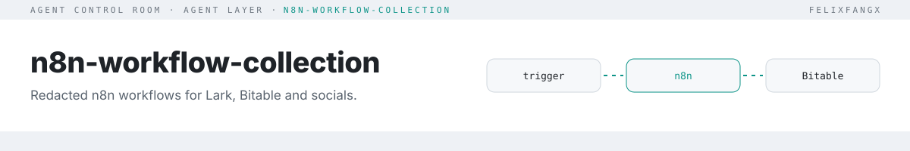

<picture>
  <source media="(prefers-color-scheme: dark)" srcset="./docs/assets/header-dark.svg">
  
</picture>

**Import-ready, redacted n8n workflows: Lark/Feishu bot messages into Bitable records and PRD drafts, plus social-media metrics tracking via Apify.** English | [简体中文（国内版）](./README.zh-CN.md)

## Editions

The workflows ship in two editions with the same structure. Start with **global**.

| Edition | Folder | Language | Services |
|---|---|---|---|
| **Global** (default) | [`workflows/global/`](./workflows/global/README.md) | English node names, comments, prompts and messages | Lark (`open.larksuite.com`), OpenAI |
| China | [`workflows/cn/`](./workflows/cn/README.md) | Chinese (localized) | Feishu (`open.feishu.cn`), DeepSeek |

The two editions expect different Bitable field names; see [field names](./workflows/global/README.md#field-names).

## Quickstart

1. In n8n, go to **Workflows → Import from file** and pick a `workflows/global/**/*.redacted.json`.
2. Replace every `{{PLACEHOLDER}}` (credentials, table IDs, webhook IDs) with your own.
3. Rebind credentials in n8n, test on a non-production Bitable, then enable.

The global edition requires n8n, the Lark Open Platform (larksuite.com) with Base/Bitable, an OpenAI API key (bot flow and table naming) and Apify (social flows; needs actor access and quota).

## Workflows (global edition)

| Workflow | Trigger | Services | Nodes | What it automates |
|---|---|---|---|---|
| [Lark / FeishuBotBitable](./workflows/global/Lark/FeishuBotBitable/README.md) | Webhook (Lark bot) | Lark, Bitable, OpenAI | 12 | Chat message → structured Bitable record + PRD draft |
| [SocialMediaTracker / Create](./workflows/global/SocialMediaTracker/Create/README.md) | Manual | Apify, Bitable | 32 | Monthly tracking table + bulk import across platforms |
| [SocialMediaTracker / Update](./workflows/global/SocialMediaTracker/Update/README.md) | Manual | Apify, Bitable | 44 | Refresh metrics for Instagram, X, YouTube, Facebook |
| [Instagram](./workflows/global/Instagram/README.md) · [X](./workflows/global/X/README.md) · [YouTube](./workflows/global/Youtube/README.md) · [Facebook](./workflows/global/Facebook/README.md) | Manual | Apify, Bitable | 17–22 | Per-platform Create / Update split-outs |

## For agents (n8n MCP)

Each workflow has a `workflow.manifest.json` next to its export ([schema](./schema/manifest.schema.json)): a description, the trigger node, input and output as JSON Schema, side effects, and a ready `execute_workflow` call. List them with `npm run manifests -- --json`. Manifests carry an `edition` (`global` or `cn`); cn ids end in `-cn`.

To let an agent (Claude, Cursor, Codex…) run them through [n8n's instance-level MCP server](https://docs.n8n.io/advanced-ai/accessing-n8n-mcp-server/):

1. Import and configure the workflow (Quickstart above), then publish it.
2. **Settings → Instance-level MCP → Enable MCP access**, then connect your client (OAuth or API key; the server URL ends in `/mcp-server/http`).
3. Open the workflow, then **… → Settings → Available in MCP**. The exports ship with this **off**.
4. **… → Edit description**: paste the manifest's `description` so `search_workflows` finds it.
5. The agent calls `execute_workflow` with `mcp.executeWorkflow` from the manifest (webhook workflows pass `inputs.webhookData.body` matching `input`), then `get_execution` for the result.

Every manifest sets `requiresConfirmation: true` because all of these workflows write to Bitable, reply in chat or spend Apify/LLM quota. Agents should ask before running them.

## How it works

```text
trigger (webhook | manual) ─▶ fetch (Lark API | Apify actor) ─▶ normalise (Code/Set) ─▶ write (Bitable) ─▶ notify
```

Each platform has a **Create** flow (build the table, first import) and an **Update** flow (refresh existing rows), so either can be re-run independently.

## Testing & redaction

```bash
npm test                  # tests for the checkers
npm run check:redaction   # scans workflows/**/*.json, prints rule + JSON path only, never the value
npm run check:manifests   # every export has a manifest that matches it (name, trigger node and type, edition)
npm run check:workflows   # JSON parses, unique node names, connections and $('Node') refs resolve, global has no CJK, editions are paired
```

Run the check before committing any new export. Only `{{UPPER_SNAKE}}` placeholders are allowed where credentials, tokens, tenant links, webhook IDs or emails would go.

## License

[MIT](./LICENSE)
